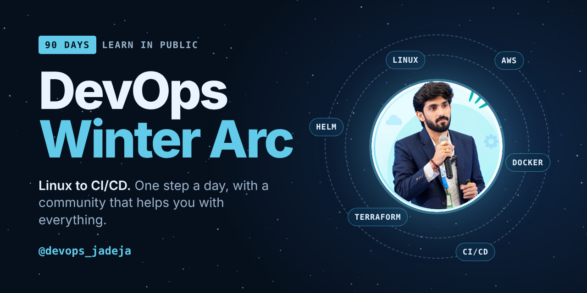

  

  
  
  
  

# DevOps Winter Arc

**90 days. One step a day. Linux to CI/CD.**
Led by **DevOps Jadeja**, who is building the DevOps universe for students who want to learn it. You learn in public, post what you learned, and we help you with everything on the way.

## The journey

| Track | What you will be able to do |
|---|---|
| **Linux, Networking, Git** | Work comfortably in a terminal, understand how machines talk, and use Git every day |
| **Docker** | Package an app into a container and run it anywhere |
| **Kubernetes** | Run and debug workloads on a real cluster, starting with `kind` on your laptop |
| **AWS** | Build and run infrastructure in the cloud |
| **Terraform and Helm** | Describe infrastructure and deployments as code |
| **CI/CD** | Ship changes automatically and safely |

Each track has its own folder in this repo with guides and small daily tasks. Start with the first folder and move forward one day at a time.

## How to take part

1. **Join the community.** [WhatsApp](https://chat.whatsapp.com/KGJNOjzBfwiE5leg8GB60I) is where announcements, doubts and daily updates happen.
2. **Learn today's topic.** Read the guide, do the task, and watch the video on [YouTube](https://www.youtube.com/@Devops_jadeja).
3. **Post on LinkedIn.** Share what you learned and tag the community.
4. **Submit your post link** using the daily form shared in the WhatsApp group.
5. **Find your star** on the Wall of Fame.

## The Wall of Fame

Every learner who posts gets a star on the [Wall of Fame](https://jadeja-rajpal.github.io/DevOps-Winter-arc/).

- **Day by day:** open any day and read every learner's post.
- **Top 10 most consistent:** ranked by days posted, then by longest streak.
- **The universe:** a star map where brighter means more days showing up.
- **Search:** type your name to see all your posts in one place.

Miss a day? Keep going. Consistency beats perfection.

## We help you with everything

Stuck on a command, an error or a concept? Ask in the [community](https://chat.whatsapp.com/KGJNOjzBfwiE5leg8GB60I). Nobody here is expected to know it all on Day 1.

---

  Made by <b>DevOps Jadeja</b> &nbsp;|&nbsp;
  <a href="https://www.youtube.com/@Devops_jadeja">YouTube</a> &nbsp;|&nbsp;
  <a href="https://www.instagram.com/devops_jadeja/">Instagram</a> &nbsp;|&nbsp;
  <a href="https://chat.whatsapp.com/KGJNOjzBfwiE5leg8GB60I">WhatsApp</a>

